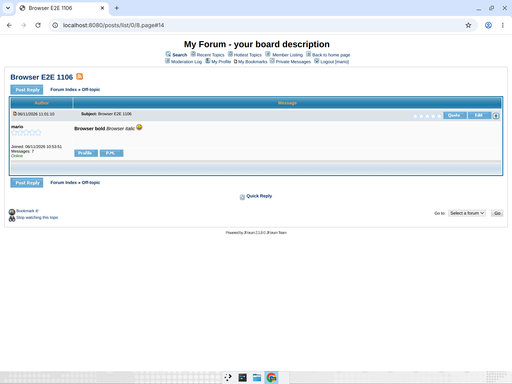
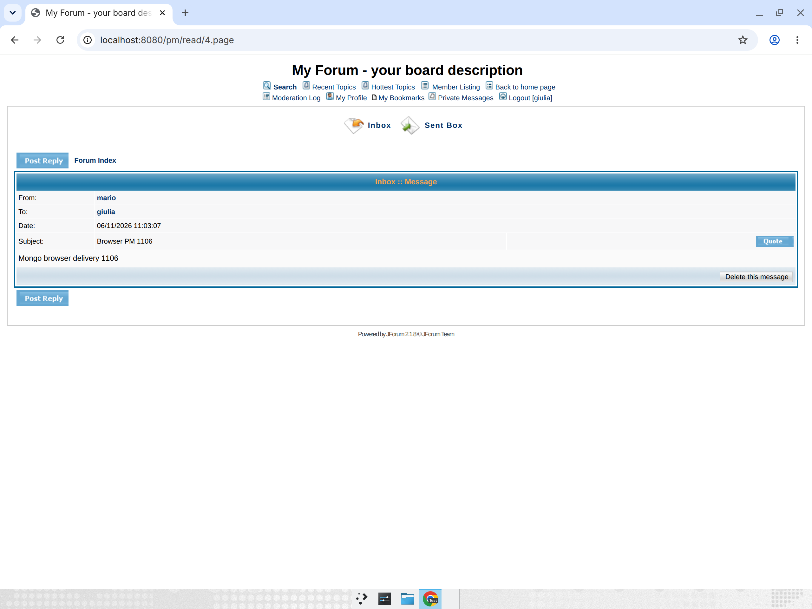
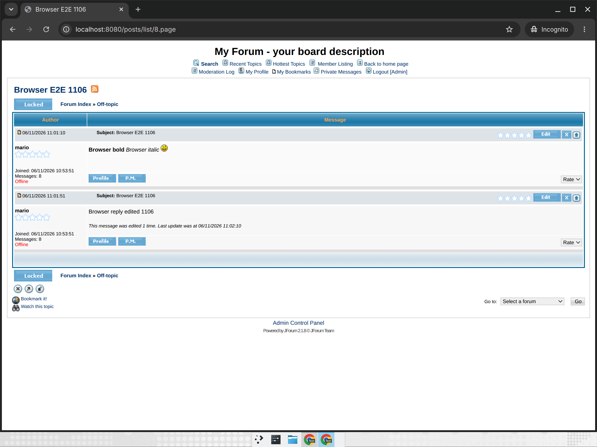
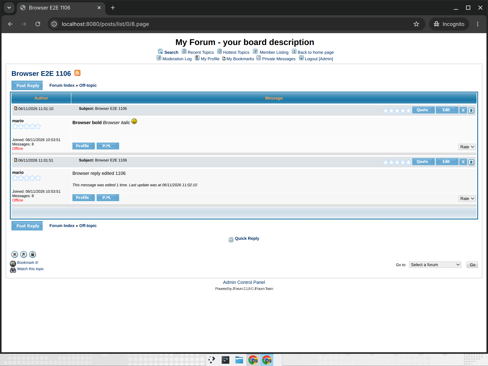
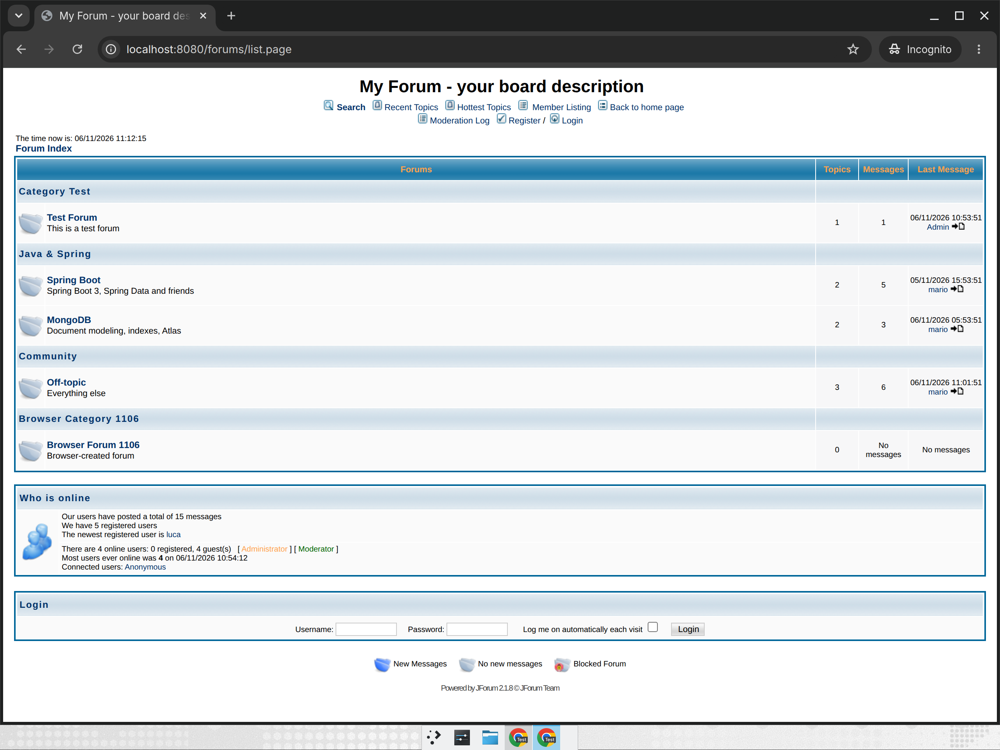
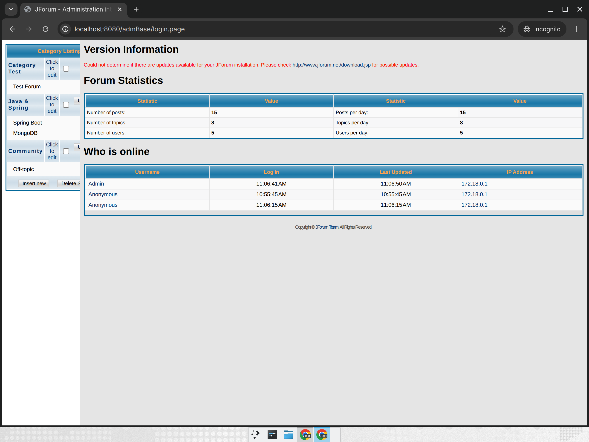

# Verification report

Run of the modernized JForum (Java 21, Spring Boot 3.5.16, Spring Data MongoDB, MongoDB 8.0) started with
`docker compose` and the `demo` seed profile. The evidence is in this directory:

- `verify.sh` – the curl script that performed the HTTP checks below (re-runnable: `docs/verification/verify.sh [base-url]`)
- `output/results.txt` – its PASS/FAIL log; `output/NN-*.html` – the raw response of every check
- `screenshots.py` + `screenshots/*.png` – headless Chrome screenshots of the main pages

## Environment

| Item | Value |
| --- | --- |
| Host | Linux 6.8 (x86_64), Docker 29.9.2, Compose 5.6.1 |
| Database | `mongo:8.0` container, server version 8.0.34, volume `mongo-data` |
| Application | image built by the multi-stage `Dockerfile` (Maven + Temurin 21 → `eclipse-temurin:21-jre`), OpenJDK 21.0.13, MongoDB Java driver 5.5.2, Tomcat 10.1.55 |
| Start command | `MAVEN_MIRROR_URL=https://maven-central-eu.storage-download.googleapis.com/maven2 SPRING_PROFILES_ACTIVE=demo docker compose up --build -d` |
| Connection | `SPRING_DATA_MONGODB_URI=mongodb://mongo:27017/jforum` (compose default) |

## Seed data (`demo` profile)

On an empty database the installation data (groups *General*/*Administration*, users *Anonymous* and *Admin*/`admin`,
smilies, roles, *Test Forum* with its welcome topic) is created first, then `DemoData` adds users `mario`, `giulia`,
`luca` (password `demo`), the categories *Java & Spring* and *Community*, the forums *Spring Boot*, *MongoDB*,
*Off-topic*, and 5 topics with replies (BBCode and smilies included).

After the run (seed + what `verify.sh` posted): 3 categories, 4 forums, 7 topics, 13 posts, 5 users, 2 private
messages (sent copy + inbox copy). Forum/topic/user counters match the documents (`forumTopics`, `topicReplies`,
`userPosts` checked against `countDocuments` per forum, topic and user).

Indexes created at startup, e.g. `posts`: `topicId`, `forumId`, `userId`, `postTime`, `needModerate`, text index
`posts_text_search`; `topics`: `forumId`, `forum_listing`, `topicLastPostId`; `users`: `usernameLower` (unique),
`userEmail`, `groupIds`.

## HTTP checks (`verify.sh`) – 43/43 PASS

| # | Check | Request | Result |
| --- | --- | --- | --- |
| 01 | Health (includes MongoDB ping) | `GET /actuator/health` | 200, `"UP"` |
| 02 | Home | `GET /` | 302 → `/forums/list.page` |
| 03 | Forum list | `GET /forums/list.page` | 200, categories and forums |
| 04 | Forum page | `GET /forums/show/2.page` | 200, topic list |
| 05 | Topic page | `GET /posts/list/2.page` | 200, all posts |
| 06 | BBCode rendering | same | `[i]…[/i]` rendered as `<i>all of them</i>` |
| 07 | Recent topics | `GET /recentTopics/list.page` | 200 |
| 08 | Member list | `GET /user/list.page` | 200 |
| 09 | User profile | `GET /user/profile/3.page` | 200 |
| 10 | Search (MongoDB text index) | `module=search&action=search&search_keywords=Atlas` | 200, matching topic found |
| 11 | RSS | `GET /rss/forumTopics/2.page` | 200, `<rss` |
| 12 | Static assets | `GET /templates/default/styles/style.css` | 200 |
| 13 | Template sources not exposed | `GET /templates/default/forum_list.htm` | 404 |
| 14 | Login form | `GET /user/login.page` | 200 |
| 15 | Registration | `GET /user/insert.page` | 200, agreement terms (first step, as in 2.1.8) |
| 16 | Anonymous cannot post | `GET /posts/insert/2.page` | 200, login required |
| 17 | Wrong password | `validateLogin` mario/wrong | 200, "Invalid" message |
| 18 | Login | `validateLogin` mario/demo | header shows `Logout [mario]` |
| 19 | New topic | `posts insertSave` in forum 4 | 302 to the new topic |
| 20 | New topic listed | `GET /forums/show/4.page` | 200, topic present |
| 21 | New topic content | `GET /posts/list/<id>.page` | `[b]verify.sh[/b]` → `<b>verify.sh</b>` |
| 22 | Reply (after the 15 s flood-control delay) | `posts insertSave` with `topic_id` | 302 |
| 23 | Reply shown | `GET /posts/list/<id>.page` | 200, reply present |
| 24 | Send PM mario → giulia | `pm sendSave` | 200 |
| 25 | Sent box | `GET /pm/sentbox.page` | PM present |
| 26 | Recipient inbox (login as giulia) | `GET /pm/inbox.page` | PM present |
| 27 | Non-admin user on admin panel | `module=admBase&action=main` as mario | 302 to the admin login (legacy behaviour) |
| 28-30 | Admin login, frameset, menu, main page | `/admBase/login.page`, `admBase&action=menu/main` | 200 |
| 31-43 | Admin panels | `adminConfig`, `adminCategories`, `adminForums`, `adminGroups`, group permissions, `adminUsers`, `adminSmilies`, `adminRankings`, `adminBanning`, `adminAttachments`, moderation log, `adminSearchStats`, `adminCache` | 200, expected content, no JForum error page |

## Other checks

| Check | Result |
| --- | --- |
| Persistence across restart | `docker compose down` (volumes kept) + `up`: the topic created by `verify.sh` is still listed; the `demo` seed is not applied twice (7 topics, 13 posts) |
| mongo-express | `docker compose --profile tools up -d mongo-express` → `http://localhost:8081` answers 200 |
| Templates unchanged | `git diff master -- templates images` is empty |
| Unit/integration tests | `mvn verify` (root): 132 tests, 0 failures, 0 errors (Testcontainers `mongo:8.0`) |
| Migration tool | `mvn verify` in `tools/migration`: 12 tests, 0 failures (Testcontainers SQL Server 2022 + `mongo:8.0`) |

## Screenshots

| File | Page |
| --- | --- |
| `01-forum-list.png` | forum list (anonymous) |
| `02-forum-show.png` | forum *Spring Boot* |
| `03-topic.png` | topic with BBCode and smilie |
| `04-login.png` | login |
| `05-search.png` | search results |
| `06-member-list.png` | member list |
| `07-logged-in-forum-list.png` | forum list as mario (who is online, last visit) |
| `08-new-topic-form.png` | new topic form |
| `09-pm-sentbox.png` | private messages, sent box |
| `10-admin-main.png` … `14-admin-group-permissions.png` | administration panel |

## Known limitations of this run

- No SMTP server is part of the compose stack: e-mail notifications (e.g. new PM) fail with
  `MailConnectException localhost:25` in the log, as the legacy application did without a mail server. Set the
  `jforum."mail.smtp.host"` keys to use a real server.
- The admin home "Version Information" box cannot reach the jforum.net version file (the page now returns HTML);
  it shows the legacy "could not determine" message and a warning is logged.
- File attachment upload and the POP mail integration were covered by the automated tests (GridFS, Testcontainers),
  not by this HTTP run.

## Recorded real-browser verification — PR #16, HEAD c1488ef

Executed the requested journey in maximized Chrome against the already-running demo Docker stack
at `http://localhost:8080`, using real MongoDB storage and the supplied Mario, Giulia and admin accounts.
No dependencies were installed or services started for this browser run. No templates were modified.
The earlier HTTP/headless results above are preserved and are separate from these browser observations.

### Browser assertions

| Check | Result and observed values | Local screenshot in `screenshots/` |
| --- | --- | --- |
| Anonymous forum index | Passed: Category Test, Java & Spring, Community; four forums. Off-topic baseline: 2 topics / 4 messages. | `browser-01-anonymous.png` |
| Existing Spring Boot topic | Passed: Migrating JForum to Spring Boot 3 opens; bold Spring Boot, italic all of them, and yellow smilie render. | `browser-02-topic.png` |
| Atlas search | Passed: Connecting to MongoDB Atlas appears as the matching result. | `browser-03-search.png` |
| Mario sign-in and topic creation | Passed: Logout [mario]; Browser E2E 1106 renders Browser bold / Browser italic / smilie, not raw BBCode. Off-topic becomes 3 topics / 5 messages with Mario as latest author. | `browser-04-created-topic.png` |
| Quick Reply and own-post edit | Passed: reply submitted 41 seconds after topic creation (15-second delay respected); Browser reply edited 1106 persists after reload and displays edited-once text. | `browser-05-edited-reply.png` |
| Reply counters | Passed: Off-topic becomes 3 topics / 6 messages. | `browser-06-counters.png` |
| PM Mario → Giulia | Passed: Giulia inbox contains Browser PM 1106 from Mario; opening it shows Mongo browser delivery 1106. | `browser-07-pm-read.png` |
| Admin statistics | Passed: 15 posts / 8 topics / 5 users after the browser topic and reply. | `browser-08-admin-stats.png` |
| Category and forum creation | Passed via direct admin routes after the frame-navigation issue below: Browser Category 1106 and Browser Forum 1106, description Browser-created forum. | `browser-09-category.png`, `browser-10-forum.png` |
| Admin users and group permissions | Passed: five users listed; General group permission controls populated and visible. No permission changes were submitted. | `browser-11-users.png`, `browser-12-permissions.png` |
| Topic lock | Passed: topic displays Locked instead of Post Reply; Off-topic list shows the padlock topic icon. | `browser-14-locked.png` |
| Topic unlock | Passed: Post Reply, Quote and Quick Reply return; Off-topic list returns to its normal topic icon. | `browser-15-unlocked.png`, `browser-16-list-unlocked.png` |
| Anonymous visibility after admin creation | Passed after logout: new category/forum visible with 0 topics and No messages; forum opens an empty topic list. | `browser-17-public-index.png`, `browser-18-empty-forum.png` |
| Visible errors/assets | No An error has occurred page or visible broken-image icon observed on the tested pages. This is not an exhaustive asset audit. | Screenshots above |

### Open item and coverage limitations

- **Admin frame navigation is unresolved.** After a fresh incognito login through `/user/login.page`,
  navigate to `/admBase/login.page` and normally left-click Categories in the narrow left menu.
  In this real-mouse session Category Listing replaced the left menu instead of loading in the wide
  main frame. A fresh retry reproduced it (`browser-13-frame-issue.png`).
  The lead separately observed correct targeting in headless Playwright and a static frameset test.
  The served markup has `leftFrame` and `main` frames and `target="main"` links; root cause is not
  determined. Do not classify this as a confirmed modernization defect or dismiss the observed issue.
  Direct `/adminCategories/list.page` and `/adminForums/list.page` worked and allowed completion.
- An earlier admin login redirect coincided with the lead signing in as admin from other clients.
  The lead identified legacy single-session-per-user eviction; fresh login after that contention stopped
  restored direct admin access. This is separate from the unresolved frame-targeting issue.
- No stock JForum runtime was supplied, so pixel-identical behavior against stock was **not verified**.
  The inspected template/asset diff was empty; that alone does not establish runtime visual parity.
- Lock/unlock were tested; moving topics was not (the request allowed either). Category/forum deletion,
  attachments, SMTP and POP integration were outside this browser journey.
- Test records remain in the demo database: topic Browser E2E 1106 (unlocked), its edited reply,
  Browser PM 1106, Browser Category 1106 and Browser Forum 1106.

### Key visual evidence

| Created topic with rendered BBCode | Giulia reads Mario's PM |
| --- | --- |
|  |  |

| 🔴 Before: locked topic | 🟢 After: unlocked topic |
| --- | --- |
|  |  |

| Anonymous index after creation | Open item: real-mouse admin frame targeting |
| --- | --- |
|  |  |

The screen recording of this run is attached to PR #16 (it is not committed to the repository).
